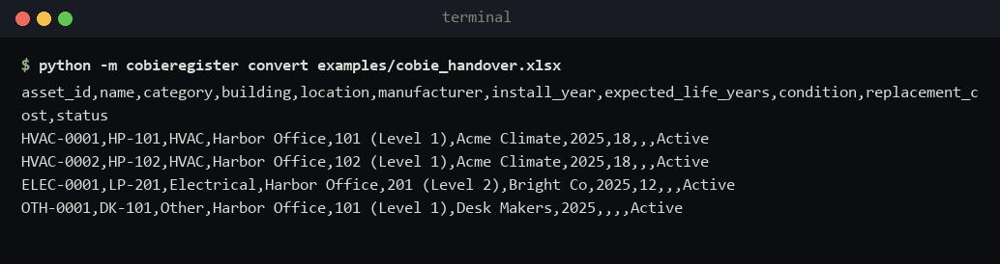

<p align="center"></p>

# cobie-to-asset-register

[](https://github.com/yassine2med/cobie-to-asset-register/actions/workflows/ci.yml)  

A COBie handover workbook describes every component in a building, but a maintenance team wants one flat asset register. This tool turns the Component, Type, Space, Floor and Facility sheets into a CSV with the columns of a facility asset register (the same columns as asset-register-template).



## What it is for

After handover, facility teams re-key COBie data into their register by hand. Use this tool to get a first draft in seconds: IDs, names, categories, building, location, manufacturer, install year and expected life are filled from the workbook, and anything that cannot be matched is reported as a warning. Condition and replacement cost are left empty because COBie does not carry them.

## Install

```
git clone https://github.com/yassine2med/cobie-to-asset-register
cd cobie-to-asset-register && pip install -r requirements.txt
```

## How to use

| I want to | Command |
|---|---|
| Print the register as CSV | `PYTHONPATH=src python -m cobieregister convert examples/cobie_handover.xlsx` |
| Write the register to a file | `PYTHONPATH=src python -m cobieregister convert examples/cobie_handover.xlsx -o register.csv` |
| Exit 1 when any row has a warning | `PYTHONPATH=src python -m cobieregister convert examples/cobie_handover.xlsx --strict` |
| Show help | `PYTHONPATH=src python -m cobieregister --help` |

Example:

```
PYTHONPATH=src python -m cobieregister convert examples/cobie_handover.xlsx
```

Output:

```
asset_id,name,category,building,location,manufacturer,install_year,expected_life_years,condition,replacement_cost,status
HVAC-0001,HP-101,HVAC,Harbor Office,101 (Level 1),Acme Climate,2025,18,,,Active
HVAC-0002,HP-102,HVAC,Harbor Office,102 (Level 1),Acme Climate,2025,18,,,Active
ELEC-0001,LP-201,Electrical,Harbor Office,201 (Level 2),Bright Co,2025,12,,,Active
OTH-0001,DK-101,Other,Harbor Office,101 (Level 1),Desk Makers,2025,,,,Active
```

Run the tests with `python -m pytest -q`.

## How it works

1. Type, Space and Facility sheets are read into lookup tables.
2. Each Component row is joined to its Type (category, manufacturer, ExpectedLife) and its Space (location is the space name plus its floor).
3. The register category is chosen by keywords in the COBie type category and type name (HVAC, Electrical, Plumbing, Fire Safety, Elevator, Envelope, otherwise Other).
4. IDs are a category prefix and a four digit counter, for example HVAC-0001, which is the pattern asset-register-template expects.
5. Install year is the year of InstallationDate. Unmatched types, spaces and dates produce warnings on stderr.

## Limits

- Needs a workbook with at least a Component sheet. Type, Space and Facility sheets improve the result.
- Keyword matching is a simple first pass; check the Other rows by hand.
- `examples/make_samples.py` rebuilds the invented sample workbook.

## License

MIT. Yassine Emhamed, 2026.
